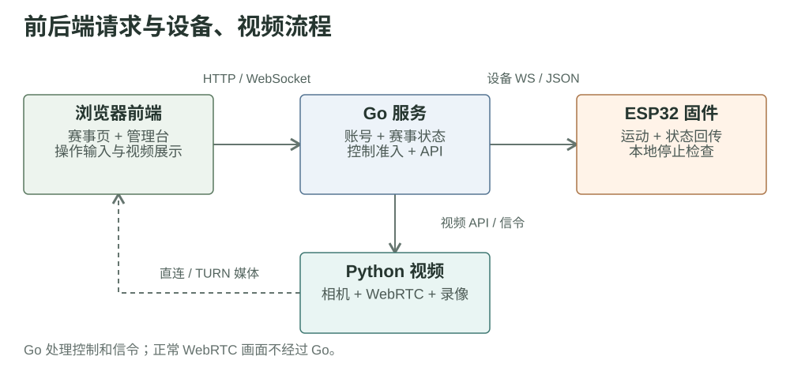

# 第一章草稿：平台需求与初始技术选型

Fish 平台需要让选手通过网页控制机器鱼、观看实时画面，并让裁判完成比赛管理、录像和回放。项目因此涉及浏览器界面、控制服务、设备固件和视频处理。下图展示当前实现的主要请求与媒体路径；当时的选型原因列在图后。

| 部分 | 当时的选择 | 选择原因 |
| --- | --- | --- |
| 控制服务 | Go | 正在学习 Go，希望借项目尝试服务器开发；此前缺少同类项目经验 |
| 视频服务 | Python | 已有可用的 Python 视频工具，可以直接复用 |
| 网页前端 | 原生页面与 React | 当时没有前后端项目经验，前端实现主要参考 AI 建议 |

上述选择形成了当前系统分工：Go 处理账号、赛事状态、设备指令和视频信令；Python 处理相机、实时画面和录像；ESP32 执行运动并保留本地停止能力。图中的虚线表示正常的 WebRTC 媒体路径；JPEG 快照降级将在视频章节说明。

基于当前实现评估，Go 与 Python 的职责边界仍然清晰。前端并存的两种实现方式增加了样式和交互维护成本；后续宜先拆分视频、控制和赛事模块，再评估是否统一界面技术栈。页面加载与视频首帧应分别测量，不能仅凭框架选择推断性能。

源码依据：[Go 依赖](https://github.com/FukunHennan/fish/blob/134699900e14ad2cbe6eeb0878e1dc55431ceab5/controller/go.mod) · [前端构建](https://github.com/FukunHennan/fish/blob/134699900e14ad2cbe6eeb0878e1dc55431ceab5/controller/frontend/vite.config.js) · [视觉依赖](https://github.com/FukunHennan/fish/blob/134699900e14ad2cbe6eeb0878e1dc55431ceab5/vision/requirements.txt)
