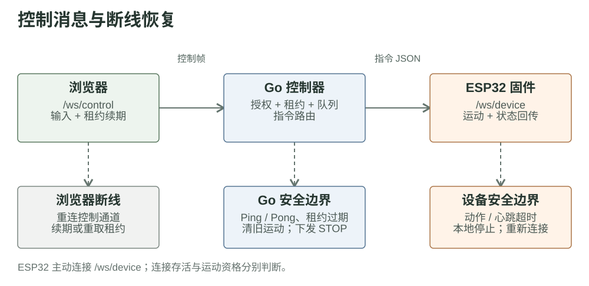
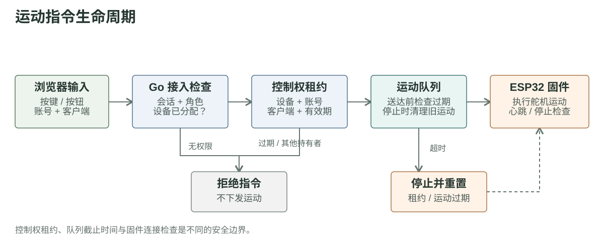

# 第二章草稿：网页与 ESP32 的通讯与连接维持

网页不直接连接机器鱼。浏览器和 ESP32 分别与 Go 保持 WebSocket：浏览器提交操作，Go 核验账号、设备归属和控制权，再向设备转发指令；设备将运动状态和遥测信息回传给 Go。

| 环节 | 当前实现 | 断线或超时时 |
| --- | --- | --- |
| 浏览器 → Go | HTTP 完成登录、设备绑定；控制指令走同源 /ws/control；设备状态通过 SSE 更新 | 控制 WebSocket 自动重连；失去租约后重新取得控制权 |
| ESP32 → Go | 设备主动连接 /ws/device，经随机挑战与 HMAC 证明身份；指令和状态使用 JSON | 固件停止运动，并尝试重新连接、注册 |
| 连接存活 | Go 对两条 WebSocket 使用 Ping / Pong；设备另发送应用心跳与状态 | 超时连接被关闭，设备被标记为离线 |
| 运动资格 | Go 检查控制租约、指令顺序和过期时间；固件检查动作有效期 | Go 清除旧运动并排入 STOP；固件可独立执行本地停止 |

连接仍然存活，不代表旧的运动指令应继续执行。当前版本中，设备连接超时与运动指令有效期是两道不同边界：设备可以在网络故障被正式判定前，先因动作过期而停止。浏览器重新建立 WebSocket 连接后，也不能绕过控制权校验直接恢复运动。

后续新增控制入口时，应复用 Go 的统一准入逻辑，并保留队列过期、STOP 和固件本地停止机制；仅依赖前端松键事件不足以保证安全。固件的安全停止会停止摆动并回到中位角度，并不等于切断舵机电源。

源码依据：[赛事页控制适配器](https://github.com/FukunHennan/fish/blob/134699900e14ad2cbe6eeb0878e1dc55431ceab5/controller/frontend/public/competition/competition-adapter.js) · [Go 控制与设备 WebSocket](https://github.com/FukunHennan/fish/blob/134699900e14ad2cbe6eeb0878e1dc55431ceab5/controller/internal/web/server.go) · [控制租约](https://github.com/FukunHennan/fish/blob/134699900e14ad2cbe6eeb0878e1dc55431ceab5/controller/internal/web/lease.go) · [队列过期](https://github.com/FukunHennan/fish/blob/134699900e14ad2cbe6eeb0878e1dc55431ceab5/controller/internal/hub/motion_timeout.go) · [固件连接与停止](https://github.com/FukunHennan/fish/blob/134699900e14ad2cbe6eeb0878e1dc55431ceab5/firmware/src/ControllerClient.cpp)
