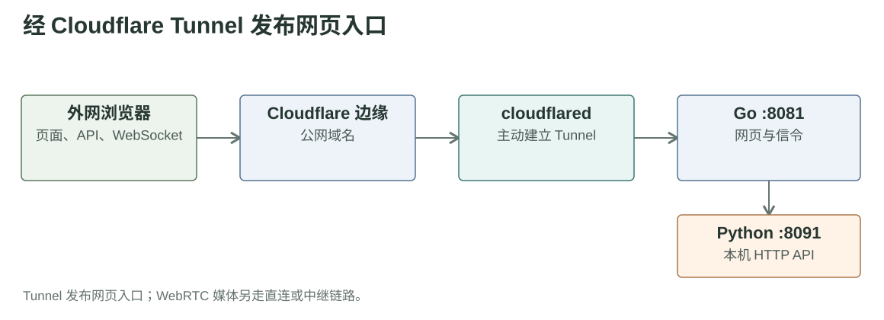

# 第三章草稿：前端访问路径与公网入口

## 问题背景

Fish 部署在本地计算机上。项目已有可长期使用的域名，但服务器缺少可供外部设备直接访问的公网 IP，外网用户最初无法打开平台网页，也无法获得实时视频。本章先解决**前端访问路径**：让浏览器能够加载页面，并向 Go 服务发送接口请求与 WebSocket 消息。视频画面的传输是另一条路径，留在第四章说明。

## 方案选择

| 前端访问内容 | 传输路径 |
| --- | --- |
| 页面与静态资源 | 浏览器 → 长期域名 → Cloudflare → Tunnel → 本机 Go 服务；Go 返回 HTML、CSS 和 JavaScript。 |
| HTTP 接口 | 浏览器沿同一入口请求 Go；视频会话与 WebRTC offer/answer 信令也通过接口交换，由 Go 调用本机 Python API。 |
| WebSocket 消息 | 浏览器沿同一入口与 Go 建立控制连接；视频快照降级也复用该同源入口，但其画面路径在第四章展开。 |

Fish 主机上的 cloudflared 主动连接 Cloudflare，外网请求再通过 Tunnel 到达 Go。这个入口承载网页、接口、控制消息和信令；浏览器与 Python 之间的正常 WebRTC 视频媒体不经过 Go，也不由 Tunnel 转发。

## 选择依据与技术边界

选择 Cloudflare Tunnel，是因为项目已有长期域名，却缺少可供外网直连的公网 IP。Tunnel 由 Fish 主机主动建立连接，使该域名能够长期作为前端入口；页面、接口和 WebSocket 服务仍由本机 Go 程序提供。

前端页面成功加载，只能说明网页入口可用，不能证明浏览器与 Fish 主机之间的视频媒体链路可用。[第四章](06-第四章视频路径草稿.md)单独讨论视频直连、TURN 中转与 JPEG 快照。

依据：[Cloudflare Tunnel 原理](https://developers.cloudflare.com/tunnel/concepts/) · [Fish 公网配置](https://github.com/FukunHennan/fish/blob/134699900e14ad2cbe6eeb0878e1dc55431ceab5/docs/%E7%A8%8B%E5%BA%8F/%E5%85%AC%E7%BD%91%E8%AE%BF%E9%97%AE%E9%85%8D%E7%BD%AE.md) · [Go 网页与接口服务](https://github.com/FukunHennan/fish/blob/134699900e14ad2cbe6eeb0878e1dc55431ceab5/controller/internal/web/server.go)
