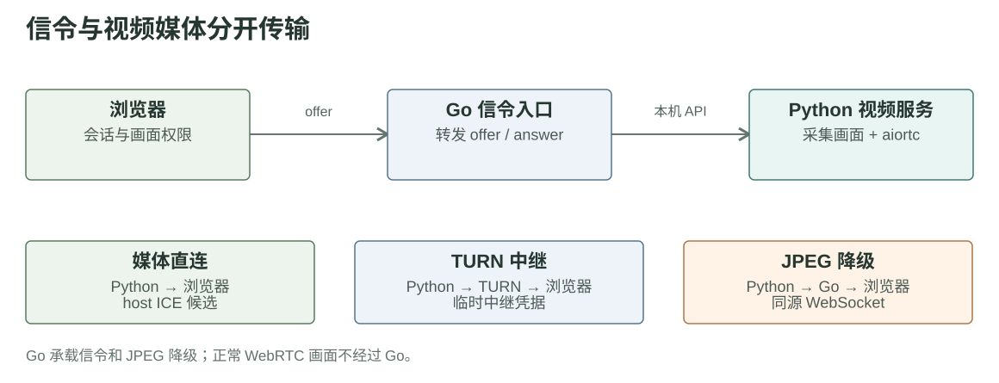
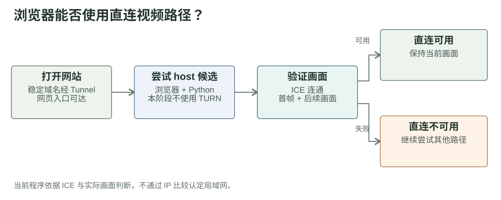
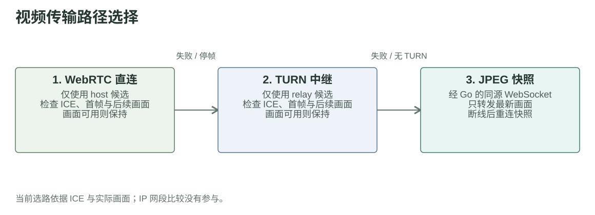

# 第四章草稿：视频媒体传输路径与降级

## 问题背景

开发过程中，外网访问端无法直接访问运行 Go/Python 视频服务的 Fish 主机，因此无法获取实时画面。第三章的前端访问路径解决了页面、接口和信令的入口；视频画面仍须通过独立的媒体路径到达浏览器。这里讨论的访问对象是 Fish 主机，不是 ESP32 机器鱼。

## 路径设计

Python 服务从相机取得画面，并通过 aiortc 提供 WebRTC 视频轨道。浏览器经第三章所述的 HTTP 接口，通过 Go 与 Python 交换 WebRTC 连接描述；视频媒体则尝试在浏览器与 Python 之间直连，或经 TURN 中转。WebRTC 两种方式均不可用时，Go 通过同源 WebSocket 转发 JPEG 快照。

| 阶段 | 传输路径 | 当前程序的处理 |
| --- | --- | --- |
| 直连 | Python → 浏览器，使用 host ICE 候选 | 首先尝试；依据连接状态及画面到达情况判断是否可用 |
| TURN | Python → TURN → 浏览器，使用 relay ICE 候选 | 直连失败后尝试；未配置或仍失败时进入快照阶段 |
| 快照 | Python → Go → 浏览器，同源 WebSocket 传输 JPEG | 只转发最新画面；连接中断后重连快照流 |

## 直连可用性判断

若能取得访问者 PC 与 Fish 主机的内网地址，比较 IP 和子网掩码可以提供“可能处于同一网段”的线索，但不能证明视频媒体可达。网页经 Tunnel 访问时，Go 也无法从请求来源还原 PC 的内网 IP。当前实现没有将 IP 比较用于选路，而是结合 WebRTC 连接状态、首帧到达及后续画面更新判断直连是否可用。

## 降级条件与选择依据

连接失败或中断、视频轨道结束、解码错误、首帧超时及持续停帧，都会触发下一阶段。因此，即使 WebRTC 显示已连接，程序仍会依据实际画面判断当前路径是否可用。

当前程序先尝试直连，再尝试 TURN。项目处于试验阶段，引入 TURN 也用于观察实际中转效果。JPEG 快照被保留为最终兜底：设计目标是在两种 WebRTC 路径均不可用时，仍尽可能通过网页同源连接取得画面。它提供另一条可用路径，但不能保证所有网络环境下都绝对稳定。

快照模式下，Go 从 Python 取得 JPEG，只向浏览器发送序号更新后的最新帧，避免积压过时画面。快照 WebSocket 断开后会重连；若网页同源连接本身不可用，这条兜底路径同样无法工作。

## 当前实现与后续目标

进入快照阶段后，同一会话只会重连快照流，不会自动升回 WebRTC。当前程序也没有依据延迟、丢包等指标持续比较多条路径并自动选择最优者。多路径自动切换仍在开发，不能把上述顺序降级写成已经完成的动态选路。

依据：[赛事页视频适配器](https://github.com/FukunHennan/fish/blob/134699900e14ad2cbe6eeb0878e1dc55431ceab5/controller/frontend/public/competition/competition-adapter.js) · [Python WebRTC 服务](https://github.com/FukunHennan/fish/blob/134699900e14ad2cbe6eeb0878e1dc55431ceab5/vision/webrtc.py) · [Go 快照入口](https://github.com/FukunHennan/fish/blob/134699900e14ad2cbe6eeb0878e1dc55431ceab5/controller/internal/web/vision_frame_socket.go) · [Cloudflare Tunnel 来源 IP 说明](https://developers.cloudflare.com/cloudflare-one/networks/connectivity-options/) · [Cloudflare TURN 临时凭据](https://developers.cloudflare.com/realtime/turn/generate-credentials/)
