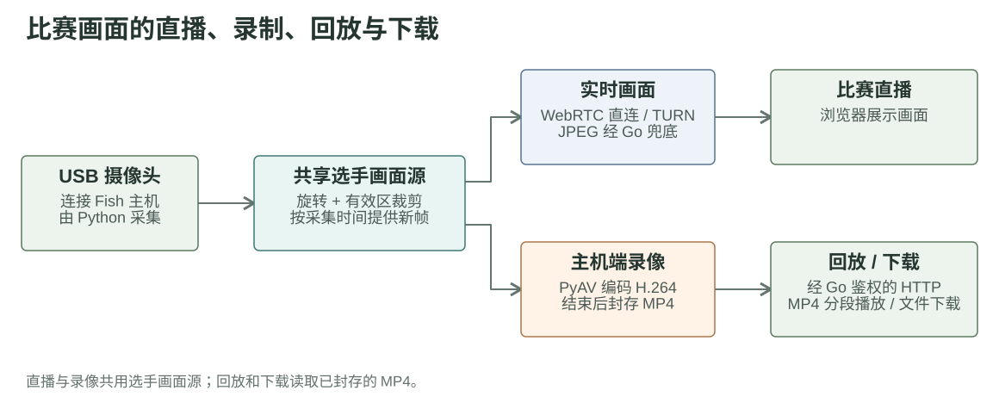
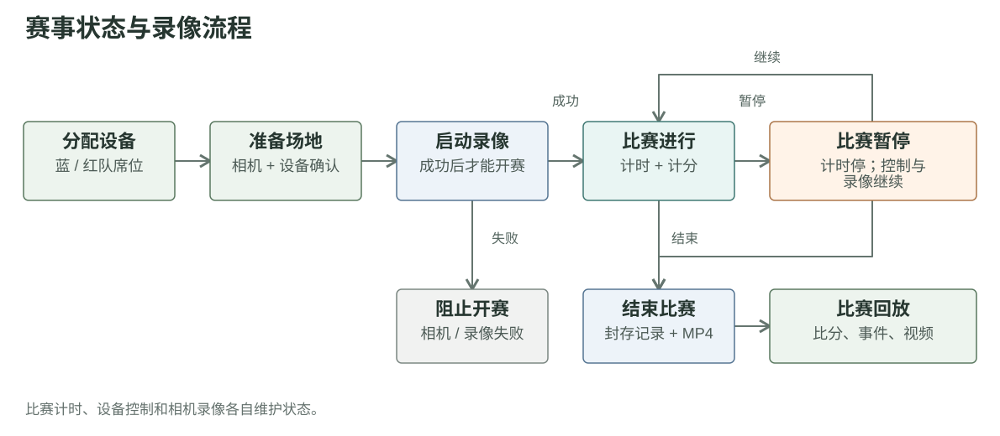

# 第五章草稿：比赛画面的实时、录制、回放与下载

## 需求与方案依据

实时画面供比赛期间观察现场；录像、回放和下载则完善了赛事结束后的资料链路，主要用于赛后复盘、争议核查与比赛资料留存。摄像头通过 USB 连接 Fish 主机，Python 视频服务已经负责采集画面，因此录像直接从主机上的画面源生成，而不是从浏览器播放画面反向录屏。

## 画面数据流程

相机帧经过旋转和选手有效区裁剪后，形成直播与录像共用的选手画面源。直播按第四章所述路径传给浏览器；录像在 Fish 主机上独立编码为 H.264 MP4。比赛结束后，浏览器再通过 Go 的认证接口读取已封存文件，用于回放或下载。

直播传输与服务器录像共用画面来源，但不是同一条输出链路。浏览器端 WebRTC 连接异常，不等同于主机端录像停止；录像仍以相机与录制服务的实际状态为准。录制线程使用真实采集时间写入帧，并限制编码帧率，不通过复制帧填补间隔。

## 比赛流程与文件访问

| 环节 | 当前实现 | 开发时需要保留的边界 |
| --- | --- | --- |
| 开始 | 确认真正的相机画面可用；Go 要求 Python 启动录像，成功后才开始比赛计时 | 录像启动失败时阻止开赛，避免产生没有画面的正式比赛 |
| 暂停 | 暂停计时，录像保持连续 | 计时状态与录像状态不能混为一谈 |
| 结束 | Python 封存 MP4，Go 将录像地址及编码统计写入比赛记录 | 回放依赖已封存文件，而非正在直播的 WebRTC 连接 |
| 回放 | 浏览器从认证的同源 HTTP 接口播放 MP4，可按计分事件跳转到对应时间 | HTTP Range 支持拖动播放；计分事件须保留可定位的时间信息 |
| 下载 | 浏览器从同一接口取得 MP4，再交给浏览器保存 | 当前实现先读取完整文件到浏览器内存，大文件可能增加内存占用 |

录像与选手比赛画面使用相同的构图；录制期间不应改变旋转角度或有效区，以免同一文件中途改变画面几何。回放和下载通过 Go 代理的 HTTP 文件接口完成，不使用直播的 TURN 链路。

依据：[录像编码实现](https://github.com/FukunHennan/fish/blob/134699900e14ad2cbe6eeb0878e1dc55431ceab5/vision/recording.py) · [赛事录像启停与记录](https://github.com/FukunHennan/fish/blob/134699900e14ad2cbe6eeb0878e1dc55431ceab5/controller/internal/web/competition.go) · [录像文件接口](https://github.com/FukunHennan/fish/blob/134699900e14ad2cbe6eeb0878e1dc55431ceab5/vision/web_api.py) · [回放与下载实现](https://github.com/FukunHennan/fish/blob/134699900e14ad2cbe6eeb0878e1dc55431ceab5/controller/frontend/public/competition/replay-transport.js)
